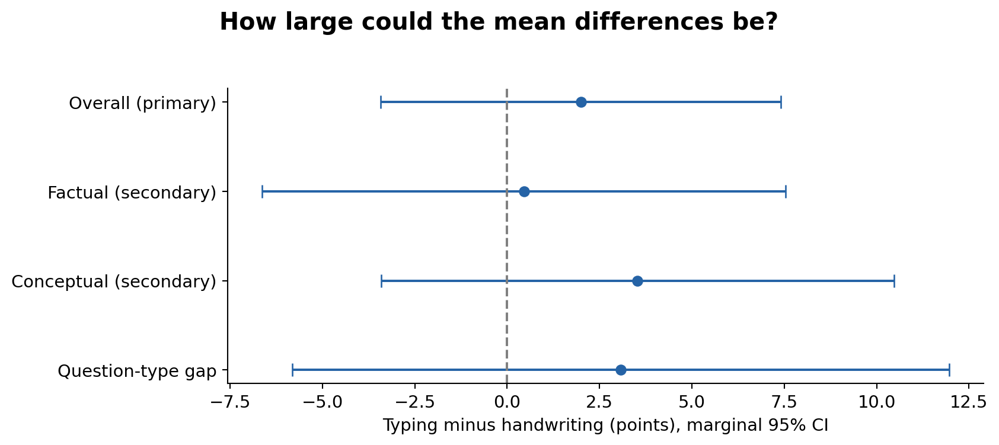

# Typing vs. Handwriting in Lectures

A reproducible IESM 324 Applied Statistics for Engineers project using public participant data from **Urry et al. (2021)**. It asks whether note-taking method changes short-term quiz performance and explains every step in plain language. **No bootstrap methods are used.**

## Read the results

- **[Download the 12-page report](reports/analysis_report.pdf)**: purpose, method, results, interpretation, assumptions and limitations.
- **[HTML report](reports/analysis_report.html)**: download the repository and open locally to see the report with linked figures.
- **[All visualizations](visualizations/README.md)**: 13 separately saved charts, each available as PNG and SVG.
- [Numerical results](results/) · [Course coverage](docs/course_mapping.md) · [Methods](docs/methods.md) · [Data dictionary](data/README.md)

## Main finding

| Quantity | Result |
|---|---:|
| Participants | 142 (68 typing, 74 handwriting) |
| Overall typing mean | 68.19 / 100 |
| Overall handwriting mean | 66.20 / 100 |
| Typing minus handwriting | +1.99 points |
| Welch 95% confidence interval | -3.43 to +7.41 points |
| Two-sided Welch test | t(139.58) = 0.726; p = 0.469 |
| Lecture-adjusted difference | +1.65 points |
| Adjusted approximate HC3 95% interval | -3.43 to +6.73 points |

**Interpretation:** The typing group had the higher sample average, but the uncertainty interval allows an advantage for either method. The study does not establish equivalence. Its quiz followed a short delay without reviewing notes, so it does not answer questions about delayed retention or studying notes.



## Analysis order

1. Validate the data; describe sample sizes, means, medians, spread, quartiles and distributions.
2. Inspect normal probability plots and distinguish assumptions for means from assumptions for individual scores.
3. Estimate the overall mean difference and test it using Welch's method.
4. Examine factual, conceptual and within-person question-type gaps; apply Holm correction to the three secondary tests.
5. Fit simple and lecture-adjusted multiple regression; inspect residuals, leverage, influence and HC3 uncertainty; examine the condition-by-lecture interaction.
6. Provide exploratory Pearson/Spearman correlations, a Mann-Whitney sensitivity check, an illustrative proportion comparison, power planning, and model-based mean/SD/prediction/tolerance intervals.

The primary comparison was carried forward from earlier project work after the data had already been examined; it is not a new preregistered analysis. Supporting analyses are exploratory. See the report for their interpretation and limits.

## Reproduce

Python 3.11 or later is recommended. The committed results record the versions actually used in `results/analysis.json`.

```sh
python3 -m venv .venv
source .venv/bin/activate
python -m pip install -r requirements.txt
python analysis/analyze.py
python analysis/build_report.py
python analysis/validate.py
```

The scripts resolve paths relative to their own location, so they can also be run from outside the project folder. No network connection, GitHub credentials or external datasets are needed to rebuild. `analyze.py` replaces generated results and figures; `build_report.py` replaces generated reports. The input CSV is never modified. Minor plot/font differences may occur across platforms. Bootstrap is not used for any calculation.

## Files

```text
data/            Original participant CSV; variable dictionary and provenance
analysis/        Analysis, report generation, validation
results/         Full-precision CSV tables, JSON outputs and data fingerprint
visualizations/  13 named PNG charts and 13 matching SVG charts
reports/         Plain-language PDF and HTML report
docs/            Methods, syllabus mapping and project history
```

## Sources and attribution

Urry, H. L., et al. (2021). *Don't Ditch the Laptop Just Yet: A Direct Replication of Mueller and Oppenheimer's (2014) Study 1 Plus Mini Meta-Analyses Across Similar Studies*. Psychological Science, 32(3), 326-339. [Paper](https://doi.org/10.1177/0956797620965541) · [Author PDF](https://static1.squarespace.com/static/587ea259197aea1c1d66ec5b/t/601f2ac8268c6a7b9735c877/1612655305004/urryetal_psci_2021.pdf) · [OSF materials](https://osf.io/tr868/).

Data: [`afex::laptop_urry`](https://singmann.r-universe.dev/afex/doc/manual.html#laptop_urry), [CSV endpoint](https://singmann.r-universe.dev/afex/data/laptop_urry/csv). The original paper's abstract reverses the group counts; Methods, detailed package documentation and the CSV support **68 laptop / 74 longhand**. This project preserves the original labels.

Course mapping follows the local August 2026 syllabus for IESM 324, Ashot Abrahamyan, Fall 2026. The syllabus, lecture PDFs and paper are linked or referenced, not redistributed. This project analyzes the packaged participant scores; it does not reproduce the paper's note-text analyses or meta-analyses.

Prepared with AI assistance; the group should review the analysis and use the disclosure required by the course. Attribution and original source rights remain with the respective authors. See [NOTICE](NOTICE.md).
